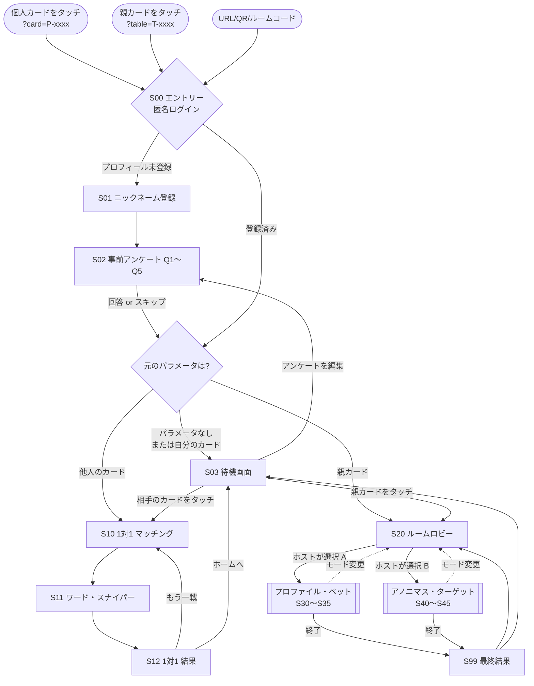
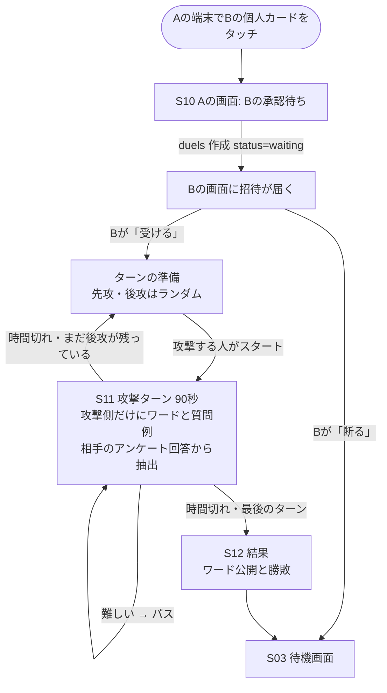
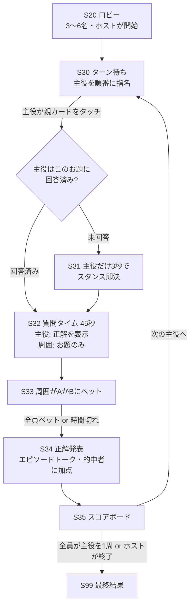
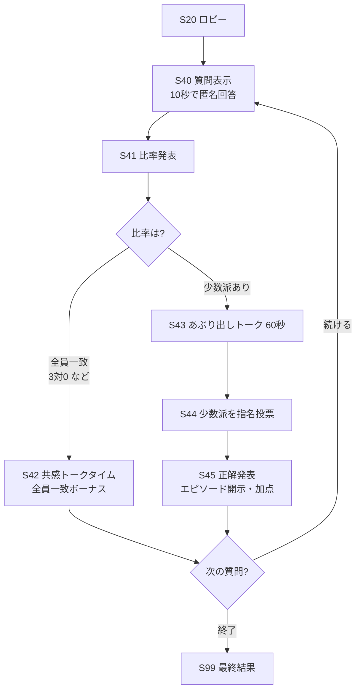
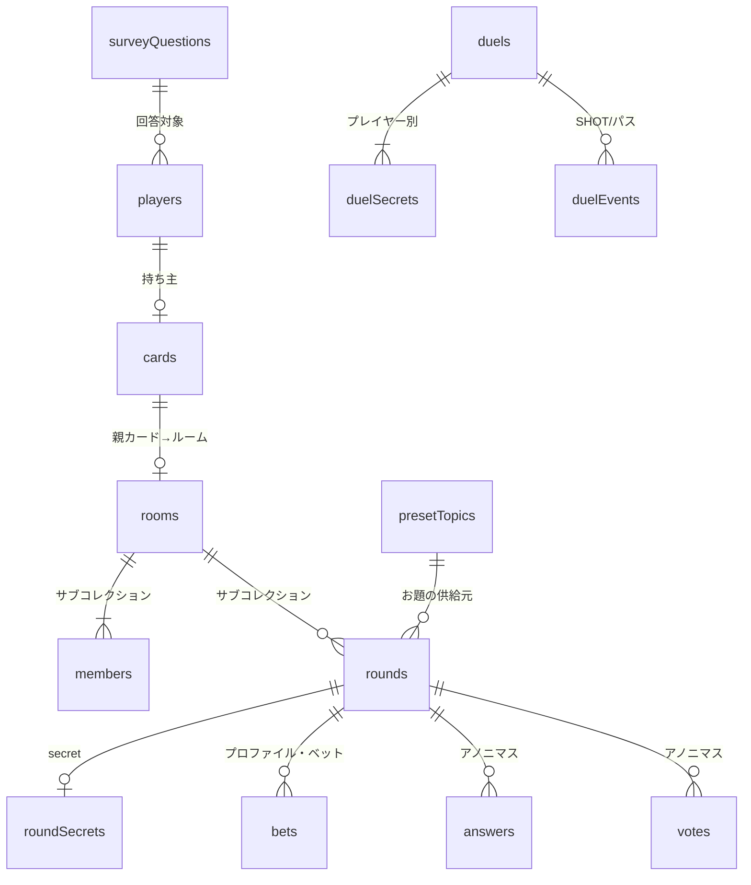

# 恋愛系NFCカードゲーム ステップ1 設計書

画面遷移図と Firebase Firestore のデータ設計をまとめたものです。ステップ2〜4の実装はこの設計に沿って進めます。

## 0. 前提と技術構成

| 項目 | 方針 |
|---|---|
| クライアント | スマホブラウザ向けの素の HTML / CSS / JavaScript（ES Modules）。ビルド不要 |
| バックエンド | Firebase（Firestore + Anonymous Authentication + Hosting） |
| 本人識別 | Firebase 匿名認証の `uid` を `playerId` として使用。端末の localStorage に保持されるため、同じブラウザなら再訪しても同一プレイヤー |
| 同期 | Firestore の `onSnapshot` でリアルタイム同期。タイマーは `phaseEndsAt`（サーバー時刻）を全員が参照して表示 |
| 進行管理 | プロトタイプでは「ルームのホスト端末」がフェーズ遷移と集計を書き込む。本番では Cloud Functions に移すことを推奨 |

### NFCタグに書き込むURL

アプリ不要で遊べるよう、NFCタグには URL だけを書き込みます（NDEF URI レコード）。

| カード種別 | 書き込むURL | 用途 |
|---|---|---|
| 個人カード（各プレイヤー1枚） | `https://<host>/index.html?card=P-xxxx` | 初回タッチで持ち主として登録。他人の端末でタッチされると「1対1モード」の対戦申し込みになる |
| 親カード（テーブル中央に1枚） | `https://<host>/index.html?table=T-xxxx` | 複数人ルームへの入室。プロファイル・ベットでは主役がタッチしてターンを起動 |

`index.html` は受け取ったパラメータを見て画面を振り分けるルーター役です。NFC非対応端末や検証用に、ルームコード入力・QRコードでも同じURLに入れるようにします。

---

## 1. 画面一覧

| ID | 画面名 | 主な表示・操作 |
|---|---|---|
| S00 | エントリー（ルーター） | URLパラメータ判定、匿名ログイン |
| S01 | ニックネーム登録 | 名前とアイコン色を入力（初回のみ） |
| S02 | 事前アンケート | Q1〜Q5 を1問ずつタップ回答。各問「スキップ」可 |
| S03 | 待機画面（ホーム） | 自分のプロフィール、回答状況、「相手のカードをタッチ」「親カードをタッチ」の案内 |
| S10 | 1対1 マッチング | 相手の承認待ち・両者そろったら開始 |
| S11 | ワード・スナイパー 対戦（ターン制） | 攻撃ターン：ワード・質問例・残り時間、SHOT／パス ボタン。守りターン：「自然に答えよう」の案内と、言わされた数 |
| S12 | 1対1 結果 | 両者のワード公開、勝敗、エピソードトークのきっかけ |
| S20 | ルームロビー | 参加者一覧（3〜6名）、ホストがモードを選択 |
| S30 | プロファイル・ベット ターン待ち | 次の主役の案内「親カードをタッチしてターン開始」 |
| S31 | スタンス即決（フォールバック） | 主役が未回答のお題だった場合のみ、主役に3秒の2択タップ |
| S32 | 質問タイム（45秒） | 主役：正解を表示／周囲：お題（2択）のみ表示 |
| S33 | ベット | 周囲が A / B に投票（主役は待機表示） |
| S34 | 正解発表＆エピソードトーク | 正解、的中者、獲得ポイント |
| S35 | スコアボード | 累計ポイント、次の主役、終了ボタン |
| S40 | アノニマス 匿名回答（10秒） | 2択の質問に匿名回答 |
| S41 | 比率発表 | 「A：2人／B：1人」など全体比率 |
| S42 | 共感トークタイム | 全員一致（3対0など）のときのボーナス画面 |
| S43 | あぶり出しトーク（60秒） | 少数派を探る会話タイム |
| S44 | 指名投票 | 「少数派だと思う人」を1人指名 |
| S45 | 正解発表＆エピソード開示 | 少数派の公開、的中者のポイント |
| S99 | 最終結果 | ルーム全体のランキング |

---

## 2. 画面遷移図

### 2.1 全体（共通基盤 → 各モード）



### 2.2 1対1モード：ワード・スナイパー



### 2.3 複数人モードA：プロファイル・ベット



3名プレイ時は周囲が2名なので、S33〜S34 は「回答者2名の直接対決」として表示します（2人のベットを左右に並べ、どちらが当てたかを強調）。

### 2.4 複数人モードB：アノニマス・ターゲット



3名で「2対1」の場合は、少数派1名を多数派2名が当てる非対称戦になります。S44 では多数派2名だけが指名し、少数派本人は「見破られないか」を待つ画面になります。4名以上で少数派が複数いる場合は「少数派だと思う人」を1人指名し、少数派の誰かに当たれば正解とします。同数（2対2など）の場合は両方を少数派扱いにせず、共感トーク（S42）に回します。

---

## 3. Firestore データ設計

### 3.1 コレクション全体図



```
players/{playerId}
cards/{cardId}
surveyQuestions/{questionId}          ← マスター（Q1〜Q5）
presetTopics/{topicId}                ← マスター（50問）
duels/{pair_uidA_uidB}
  └─ secrets/{playerId}
rooms/{roomId}
  ├─ members/{playerId}
  └─ rounds/{roundId}
       ├─ secret/answer               ← プロファイル・ベットの正解（主役のみ閲覧）
       ├─ bets/{playerId}
       ├─ answers/{playerId}
       └─ votes/{playerId}
```

### 3.2 マスターデータ

#### `surveyQuestions/{questionId}`（q1〜q5）

| フィールド | 型 | 例 |
|---|---|---|
| `order` | number | `1` |
| `text` | string | `"初デートの食事代"` |
| `options` | map | `{ A: {...}, B: {...} }` |
| `options.A.label` | string | `"完全割り勘"` |
| `options.A.targetWords` | array\<map\> | `[{ word: "割り勘", questions: ["友達とごはんに行ったら、お会計ってどうしてる？", …] }, …]` |
| `options.B.label` | string | `"どちらかが多めに払う"` |
| `options.B.targetWords` | array\<map\> | `[{ word: "おごる", questions: […] }, { word: "払う", questions: […] }]` |
| `betPrompt` | string | `"〇〇さんは初デートの食事代、どっち派？"` |

`targetWords` はワード・スナイパー用です。相手が選んだ**回答そのものの言葉**（その話題になれば本人が自然に口にする語）をターゲットにします。`questions` はそのワードを言わせるための質問例で、攻撃ターンにそのまま読み上げられる形にしています。守る側は質問に自然に答えるだけで、わざとワードを避けるのはなしです。仕様上は2択ですが、`options` を map にしているので将来 C を追加して3択にもできます。

#### `presetTopics/{topicId}`（50問のフォールバック用お題プール）

| フィールド | 型 | 説明 |
|---|---|---|
| `text` | string | お題本文 |
| `type` | string | `"binary"`（2択）または `"talk"`（トークテーマ） |
| `optionA` / `optionB` | string \| null | 2択の選択肢（`talk` は null） |
| `targetWords` | array\<map\> | ワード・スナイパー用の候補語と質問例 `{ word, questions }`（`talk` のみ。その話題になれば誰でも口にする語） |
| `spicy` | number | きわどさ 1〜3。アノニマス・ターゲットは 2 以上から出題 |
| `modes` | array\<string\> | 使えるモード `["sniper","bet","anonymous"]` |
| `random` | number | 0〜1 の乱数。`where("random", ">=", r).limit(1)` でランダム抽選するため |

50問の内訳案：トークテーマ（1対1向け）15問、一般2択（プロファイル・ベット向け）15問、恋愛・過去のきわどい2択（アノニマス向け）20問。具体的な50問の本文はステップ2で JSON として用意します。

### 3.3 プレイヤーとカード

#### `players/{playerId}`（playerId = 匿名認証の uid）

| フィールド | 型 | 説明 |
|---|---|---|
| `nickname` | string | 表示名 |
| `color` | string | アイコン色（例 `"#FF7A9A"`） |
| `cardId` | string \| null | 紐づいた個人カード |
| `survey` | map | `{ q1: "A", q2: null, q3: "B", q4: null, q5: "A" }`。未回答は null |
| `answeredCount` | number | 回答済みの数（0〜5）。待機画面の表示とお題抽選で使用 |
| `currentRoomId` | string \| null | 参加中のルーム |
| `currentDuelId` | string \| null | 進行中の1対1 |
| `createdAt` / `updatedAt` | timestamp | |

#### `cards/{cardId}`

| フィールド | 型 | 説明 |
|---|---|---|
| `kind` | string | `"player"` または `"table"` |
| `ownerId` | string \| null | 個人カードの持ち主。未登録カードは最初にタッチした人が持ち主になる |
| `roomId` | string \| null | 親カードに紐づく現在のルーム |
| `label` | string | 印字名（例 `"ハート♥3"`） |

親カードをタッチしたとき、`roomId` が空か終了済みなら新しいルームを作って `roomId` を書き換え、最初の入室者をホストにします。

### 3.4 1対1モード

ステップ3の実装に合わせて更新しました。同じ2人の対戦は、ドキュメントIDを `pair_{小さい方のuid}_{大きい方のuid}` に固定しています。どちらが相手のカードをタッチしても同じ対戦に合流でき、「もう一戦」はラウンド番号を進めて同じドキュメントを使い直します。

#### `duels/{pair_uidA_uidB}`

| フィールド | 型 | 説明 |
|---|---|---|
| `playerIds` | array\<string\> | 2人の uid（昇順） |
| `players` | map | `{ uid: { nickname, color } }` 表示用のコピー |
| `status` | string | `"waiting"` → `"playing"` → `"finished"`。断ったときは `"cancelled"` |
| `round` | number | 何戦目か（もう一戦で +1） |
| `joined` | map | `{ uid: true/false }` 両方 true になった瞬間に `playing` へ |
| `startedAt` | timestamp | 2人がそろった時刻 |
| `turnOrder` | array\<string\> | `[先攻のuid, 後攻のuid]`（ラウンドを作るときにランダムで決める） |
| `turnIndex` | number | 今何ターン目か（0 始まり）。攻撃する人は `turnOrder[turnIndex % 2]` |
| `turnPhase` | string | `"ready"`（攻撃する人のスタート待ち）→ `"active"`（攻撃中） |
| `turnStartedAt` | timestamp \| null | ターンの開始時刻（サーバー時刻）。残り時間は `turnStartedAt + turnSec` で2台とも同じに計算 |
| `turnSec` | number | `90` |
| `totalTurns` | number | `2`（先攻・後攻1回ずつ） |
| `scores` | map | `{ uidA: 0, uidB: 0 }` |
| `history` | array\<map\> | `{ type, actor, owner, turn, word, sourceLabel, at }`。type は `shot` / `pass` / `left`（時間切れで残ったワード） |
| `revealed` | map | `{ t0: true, t1: true }` ターンが終わって、そのターンの残りワードを公開済みか |
| `createdAt` / `updatedAt` | timestamp | |

#### `duels/{id}/secrets/{playerId}`（本人しか読み書きできない）

| フィールド | 型 | 説明 |
|---|---|---|
| `round` / `turn` | number | どのラウンドの何ターン目のワードか |
| `targetWord` | string | 今のワード |
| `questions` | array\<string\> | そのワードを言わせる質問例（攻撃中に表示） |
| `wordNo` | number | このターンで何個目のワードか |
| `used` | array\<string\> | このラウンドで使ったワード（重複を避ける） |
| `source` / `sourceRef` | string | `"survey"` / `"q3.B"`、または `"preset"` / `"preset:t05"` |
| `sourceLabel` | string | 結果画面に出す出どころ（例「相手のアンケート『休日の予定は？』の回答『外出・アクティブ』から」） |
| `hintTheme` | string | 話題（アンケートの theme、またはトークテーマ） |
| `hintAnswer` | string | 相手の回答（例「Aさんは『休日の予定は？』に『家から一歩も出ない』と回答」）。質問例の下に表示 |

得点ルール：先攻・後攻が交代で攻撃します。攻撃する人だけがワードを持ち、質問して相手に言わせたら SHOT（自己申告）で +1 し、次のワードを引きます。パスは 0 点で次のワードへ。守る人は質問に自然に答えるだけです（わざと避けるのはなし）。言わせたワードの数で勝敗を決めます。当初案の COUNTER（守る側がワードを見破る）は、ターン制では守る側が狙いを知っているため、質問を聞いた時点で言い当てられて攻撃が成り立たなくなるので、なくしました。ログは当初案の `events` サブコレクションをやめ、対戦ドキュメントの `history` にまとめました。

### 3.5 複数人モード

#### `rooms/{roomId}`

| フィールド | 型 | 説明 |
|---|---|---|
| `tableCardId` | string | 親カード |
| `code` | string | 4桁のルームコード（NFCが使えない人用） |
| `hostId` | string | 進行を書き込む端末 |
| `memberIds` | array\<string\> | 入室順。3〜6名 |
| `status` | string | `"lobby"` / `"playing"` / `"finished"` |
| `mode` | string \| null | `"profileBet"` / `"anonymous"` |
| `currentRoundId` | string \| null | 進行中のラウンド |
| `roundNo` | number | 何ラウンド目か |
| `turnOrder` | array\<string\> | プロファイル・ベットの主役順 |
| `turnIndex` | number | 現在の主役の位置 |
| `usedTopicRefs` | array\<string\> | 出題済みお題（重複防止） |
| `createdAt` | timestamp | |

#### `rooms/{roomId}/members/{playerId}`

| フィールド | 型 | 説明 |
|---|---|---|
| `nickname` / `color` | string | 表示用コピー |
| `score` | number | 累計ポイント |
| `joinedAt` | timestamp | |
| `lastSeenAt` | timestamp | 30秒ごとに更新し、切断判定に使う |

#### `rooms/{roomId}/rounds/{roundId}`（両モード共通の進行ドキュメント）

| フィールド | 型 | 説明 |
|---|---|---|
| `mode` | string | `"profileBet"` / `"anonymous"` |
| `phase` | string | 下表を参照 |
| `phaseEndsAt` | timestamp \| null | 各フェーズの締切（全員の残り時間表示に使う） |
| `question` | map | `{ text, optionA, optionB, source: "survey"\|"preset", ref }` |
| `protagonistId` | string \| null | プロファイル・ベットの主役 |
| `needsStance` | boolean | 主役が未回答で S31 が必要か |
| `participantIds` | array\<string\> | このラウンドで回答・ベットする人 |
| `result` | map \| null | 発表用の集計（下記） |

`phase` の値と対応画面：

| モード | phase | 画面 | 制限時間 |
|---|---|---|---|
| profileBet | `waitingTouch` | S30 | なし |
| profileBet | `stance` | S31 | 3秒（超過時はランダム決定） |
| profileBet | `questioning` | S32 | 45秒 |
| profileBet | `betting` | S33 | 15秒 |
| profileBet | `reveal` | S34 → S35 | なし（ホストが次へ） |
| anonymous | `answering` | S40 | 10秒 |
| anonymous | `ratio` | S41 | 5秒 |
| anonymous | `empathy` | S42 | 60秒 |
| anonymous | `discussion` | S43 | 60秒 |
| anonymous | `voting` | S44 | 15秒 |
| anonymous | `reveal` | S45 | なし |

`result` の中身：

- プロファイル・ベット：`{ correct: "A", winners: [uid...], counts: { A: 2, B: 1 } }`
- アノニマス・ターゲット：`{ counts: { A: 2, B: 1 }, minorityIds: [uid], unanimous: false, winners: [uid...] }`

#### `rooms/{roomId}/rounds/{roundId}/secret/answer`（プロファイル・ベットのみ）

| フィールド | 型 | 説明 |
|---|---|---|
| `choice` | string | 主役の正解 `"A"` / `"B"` |
| `source` | string | `"survey"`（事前回答）または `"stance"`（S31で即決） |

主役本人だけが読めます。`reveal` フェーズでホスト端末が `result.correct` に写して全員に公開します（プロトタイプでは主役の端末が公開を書き込む方式にして、ホストにも事前に見えないようにします）。

#### `rooms/{roomId}/rounds/{roundId}/bets/{playerId}`

| フィールド | 型 |
|---|---|
| `choice` | `"A"` / `"B"` |
| `at` | timestamp |

#### `rooms/{roomId}/rounds/{roundId}/answers/{playerId}`（アノニマス）

| フィールド | 型 |
|---|---|
| `choice` | `"A"` / `"B"` |
| `at` | timestamp |

#### `rooms/{roomId}/rounds/{roundId}/votes/{playerId}`（アノニマス）

| フィールド | 型 |
|---|---|
| `targetId` | string（少数派だと思う人） |
| `at` | timestamp |

---

## 4. お題の抽出ロジック（フォールバック込み）

| 場面 | 優先 | フォールバック |
|---|---|---|
| ワード・スナイパー | 相手の回答済みの問いの選択肢の `targetWords` から1語（このラウンドでまだ出していない問いを優先） | 相手が全問未回答（または使い切った）なら `presetTopics`（type=talk）から抽選し、その `targetWords` から1語 |
| プロファイル・ベット | 主役の回答済みの問いのうち、このルームで未出題のもの | 主役が未回答なら `presetTopics`（type=binary）から抽選し、S31 で主役が3秒で即決 |
| アノニマス・ターゲット | `presetTopics`（modes に anonymous を含み spicy≥2）から未出題を抽選 | 全員がその場で回答するため不要 |

ゲームが止まらないことを最優先に、マスターデータの読み込みに失敗した場合もクライアントに同梱した `presets.json` から抽選します。

---

## 5. セキュリティルールの要点

```
players/{uid}             : 本人だけ書き込み。同じルームのメンバーは読み取り可
cards/{cardId}            : 誰でも読み取り。ownerId は null のときだけ書き込み可
duels/{id}                : playerIds に含まれる人だけ読み書き
duels/{id}/secrets/{uid}  : request.auth.uid == uid のときだけ読み取り
rooms/{id}                : memberIds に含まれる人が読み取り。進行フィールドは hostId だけ更新
rounds/.../secret/answer  : protagonistId 本人だけ読み書き
bets|answers|votes/{uid}  : 本人だけ作成・更新（締切後は不可）
```

アノニマスの `answers` は集計のためにホスト端末が読む必要があります。プロトタイプではホストが読める状態を許容し、画面には個別回答を出さない作りにします。完全な匿名性が必要になったら、集計を Cloud Functions に移して `answers` をクライアントから読めなくします。

---

## 6. ステップ2以降のファイル構成（予定）

```
public/
  index.html        S00 ルーター
  profile.html      S01・S02 ニックネーム登録とアンケート
  lobby.html        S03 待機画面 ／ S20 ルームロビー
  sniper.html       S10〜S12 ワード・スナイパー
  bet.html          S30〜S35 プロファイル・ベット
  anonymous.html    S40〜S45 アノニマス・ターゲット（依頼範囲外だが設計済み）
  css/common.css
  js/firebase.js    初期化と匿名ログイン
  js/store.js       Firestore 読み書きの共通関数
  js/topics.js      お題抽出ロジック
  data/presets.json 50問のプリセット
```
